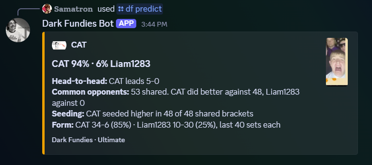
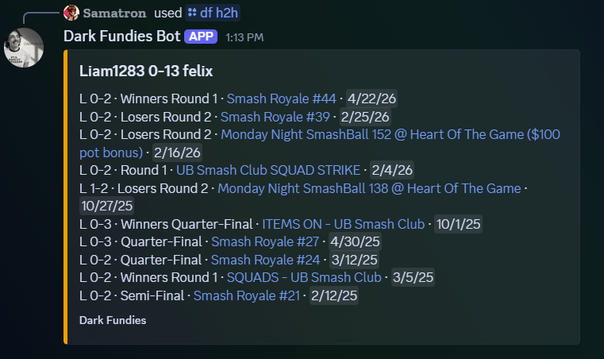
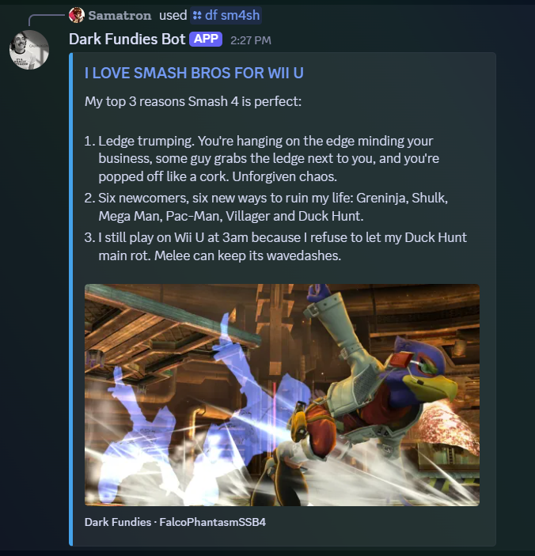
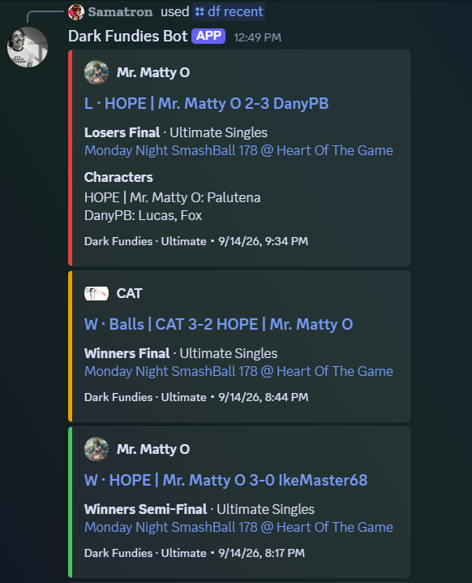

# Sama-tracker

 

 

See it running in [this Discord server](https://discord.gg/VuMz7Y2k2).

Follows start.gg players and posts to a Discord channel when one of them:

- finishes a set. Only their first DQ in an event gets posted, and big wins over higher seeds are marked as major upsets
- has a set on stream, called or at the front of the stream queue
- is entered in a tournament starting within the hour, if 3 or more of the crew are
- finishes a tournament, with where everyone placed. That waits 12 hours after the end since TOs often report top 4 late, or 24 if someone's placement still isn't in. After that it posts anyway, with start.gg's projected placement for anyone left in an unfinished bracket

Every Sunday at 9 pm New York time it also posts a weekly crew recap with everyone's results, the biggest upset, the best finish and what they're signed up for next week. Only tracked players with at least one singles set that wasn't a DQ get in, and a week where nobody played posts nothing. `/messages` changes the day, time and timezone, or turns it off.

Recap placements come from finished events where the player played a set that week, even if the event started the week before. If the bot is down when the recap is due, it still goes out once it's back, as long as that's within a day. A restart partway through sends whatever hadn't gone out yet instead of starting over.

It also pings everyone who turned on reg pings when registration is about to close for a tournament someone set a reminder for, or one a reg admin runs.

## Setup

1. Create an app at https://discord.com/developers/applications and add a bot. Invite it with the `bot` and `applications.commands` scopes and the View Channel, Send Messages, Embed Links, Attach Files and Manage Roles permissions. Manage Roles is only for the Reg Reminders role. It doesn't need any privileged intents.
2. Make a start.gg API token under Settings > Developer Settings.
3. Copy `.env.example` to `.env` and fill it in. With Developer Mode on in Discord, right-click the server and the channel to copy their IDs. `ANTHROPIC_API_KEY` and `YOUTUBE_API_KEY` are optional. For the YouTube one, make a project in the Google Cloud Console, enable YouTube Data API v3 and create an API key under Credentials.
4. `npm install` and `npm start`. Needs Node 22.9+. `npm run dev` restarts it when you save a file. `npm test` runs the tests, which fake Discord and start.gg, so they never post anything.

Only run one copy at a time or everything gets posted twice.

### Railway

1. New project, deploy from this GitHub repo.
2. Put everything from `.env.example` in the service's Variables.
3. Right-click the canvas, add a volume and connect it to the service. Any mount path works. Without it the tracked players get wiped on every deploy.

Pushing to GitHub redeploys it.

### Discord name and roles

The app and bot username are `Sama-tracker` in the Discord Developer Portal. You can also rename the bot's server role to `Sama-tracker`. Keep its permissions and position, above `Reg Reminders`, so it can assign that role.

Keep the `Reg Reminders` name because `/reg_role` looks it up by name. Message footers come from `src/embeds.js`, and changing them there only affects new messages.

`/messages` always needs Manage Server. `/socials_edit` needs it by default, and you can hand it to other roles under Server Settings > Integrations > Sama-tracker.

## Commands

### General

```
/help                                          show the commands
/status                                        uptime, which machine, last start.gg checks
/socials                                       streams and social links saved for this server
/socials_edit add name:<who> link:<url>        add a link
/socials_edit remove link:<link>               remove one
/profile user:<@someone>                       their start.gg profile, if it has their Discord connected
/messages                                      show or change automatic posts
```

`/socials` lists the links saved with `/socials_edit`, so they live in the bot's data instead of the code. Links with the same name go on one line, labeled by site: X, Twitch, YouTube, Instagram, TikTok, Bluesky, Kick, Facebook, Threads and Discord. Links to anything else show in full. The `https://` is optional.

```
/socials_edit add name:abbrchive link:youtube.com/@abbrchive/featured
```

`/profile` links a server member's start.gg profile, or yours if you leave `user` out. It only counts a start.gg that has their Discord connected, checked on start.gg each time, so nobody can claim someone else's. start.gg can't be searched by Discord, so the bot goes through the accounts it already knows: tracked players, `/link`, and anyone it has seen registered with Discord connected through reg reminders, `/registered` or `/reg_warn`. It keeps the last 5000 of those. If none match, it reads who's registered for the current reg reminder tournaments. Someone it can't find can connect Discord on start.gg and run `/link`.

`/messages` turns each kind of automatic post on or off for the whole server and sets when the recap goes out. Every option is optional, so you can change several at once, or run it with none to see where things stand. Changes save right away and survive restarts.

```
/messages sets:False streams:False
/messages rollcall:False results:True registration:True recap:True
/messages recap_day:Sunday recap_time:20:00 timezone:America/New_York
```

The six switches are set results, stream alerts, tournament roll calls, tournament placements, registration reminders and the weekly recap. Whatever comes due while one is off gets skipped for good, so turning it back on doesn't dump what you missed. That holds even if the bot hadn't checked yet when you flipped it. Per-player `/stream` settings and personal `/reg_role` pings still apply on top.

Recap times are 24-hour `HH:MM` in a timezone like `America/New_York`, `America/Los_Angeles`, `Europe/London` or `UTC`. A new schedule starts with the next recap instead of sending one that's overdue. If daylight saving skips your time, the recap moves up by the jump, and a time that happens twice uses the first one.

### Player tracking

```
/track add profile:<link or ID>                track a start.gg player
/track remove player:<name>                    stop tracking someone
/track list                                    everyone being tracked
/upcoming                                      your tournaments, live ones first
/recent                                        your last 5 sets
/run                                           your current tournament run and next opponent
/stream player:<name or all> alerts:<on|off>   on-stream alerts on or off
```

Only tracked players get their sets, streams and placements posted, and only tracked players can be picked as the `player` in a command. If someone isn't in the list, `/track add` them first. `/upcoming`, `/recent` and `/stream` also take `player:all`. For `/recent` that's the 20 newest sets, 3 per player at most.

### Looking yourself up

```
/link profile:<link or ID>                     link your start.gg without getting tracked
/unlink                                        undo it
```

Leave the player out of `/upcoming`, `/recent`, `/run`, `/progress`, `/h2h`, `/stats`, `/characters` or `/predict` and it looks you up. If you're tracked and your start.gg has your Discord connected, that works with no setup, and `/link` says you don't need it instead of linking. Anyone else runs `/link` once. It checks that the start.gg profile has your Discord connected, so nobody can link as someone else. The reply lists the commands that work now.

Linking doesn't track you. You won't be in `/track list` or the player picker, so typing your own name won't find you; leave it blank. Nothing about you gets posted, `/stream` has nothing to turn off, and those commands look you up on start.gg each time instead.

### Player stats

```
/h2h opponent:<name>                           your record against them, DQs left out
/h2h opponent:<name> verbose:True              every set, plus splits and streaks
/stats                                         recent set record, best finish, biggest upset
/stats verbose:True                            lifetime report
/characters                                    characters from reported Ultimate or Melee games
/characters game:Melee                         just Melee, or game:Ultimate for just Ultimate
/characters verbose:True                       every game with characters reported
/predict opponent:<name>                       your odds of beating them
/predict opponent:<name> verbose:True          how each part of the prediction counts
/scout profile:<link or ID>                    scout any opponent, for tracked players
/scout profile:<link or ID> verbose:True       their whole history, habits, stages, your odds
/progress                                      last 30 days against the 30 before, by game
/progress verbose:True                         more on each period, plus 6 months of trend
```

Leaving out `player` looks up whoever ran the command. Add `player:<name>` for someone tracked instead, like `/h2h opponent:Sparg0 player:Leo`.

`verbose` is off unless you add `verbose:True`. Discord makes you pick True or False once you add the option, so leaving it out is how you get the short version.

### Registration

```
/set_reg_reminder tournament:<link>            ping people before registration closes
/delete_reg_reminder tournament:<name>         cancel a reg reminder
/reg_admin add profile:<link or ID>            reminders for every tournament they admin
/reg_admin remove admin:<name>                 stop doing that for them
/reg_admin list                                every reg admin
/reg_role ping:<on|off>                        reg reminder pings for yourself
/bracket                                       bracket links for live reg reminder tournaments
/registered tournament:<link>                  who in this server is registered
/reg_warn tournament:<link> user:<@someone>    warn someone who isn't registered yet
```

### Fun

```
/sm4sh                                         I LOVE SMASH BROS FOR WII U
/melee                                         MELEE IS THE ONLY REAL SMASH GAME
/ult                                           I HATE SMASH BROS ULTIMATE
/64                                            SMASH 64 DID IT FIRST
/brawl                                         BRAWL WAS GOOD ACTUALLY
/pplus                                         HAVE YOU HEARD ABOUT PROJECT+
/pfp                                           the bot's profile picture, full size
```

### Command notes

`profile` takes a link like `start.gg/user/f64a83c8` or just the ID at the end. `player` and `opponent` autocomplete from the tracked list. If nothing matches, the list says so instead of sitting there empty.

Reg reminders go out a week, 3 days and a day before registration closes, then a last call 12 hours before. If registration stays open after the tournament starts, the start counts as the deadline. Ones already past when you set it get skipped, except the last call, which goes out right away inside those 12 hours.

Tournaments a reg admin is an admin of on start.gg get reminders set on their own, checked every 15 minutes. Deleting one with `/delete_reg_reminder` keeps it from coming back.

`/bracket` links every event's bracket for reg reminder tournaments from 30 minutes before they start until 6 hours after their end time.

Pings go to whoever turned them on with `/reg_role`, which only ever changes your own setting. If your Discord is connected on start.gg, you don't get pinged for tournaments you're already registered for. The bot also gives you a Reg Reminders role so everyone can see who's in.

`/registered` is `/upcoming` for one tournament, going by everyone in the server instead of the tracked list. It lists each person by start.gg tag, with their server name after it when that's different, and the events they're in. It uses names instead of mentions, so nobody gets pinged. start.gg only knows someone's Discord if they connected it there, so people who didn't won't show up, and the card says how many of the registered players have.

`/reg_warn` is a manual, half-serious nudge. If they're registered it says "Already registered." and leaves them alone, with no mention and no ping. If they aren't, it pings them with a warning and the register link. It also goes by the Discord connected on start.gg, so the warning tells them to connect it if they did register. Once registration closes it just says so.

`/h2h` goes through up to 600 singles sets each and lists the last 10 meetings. With `verbose:True` it goes through up to 3000 each and lists every set, plus the record by game, as the higher and the lower seed and in grand finals, the current streak and when they first played.

`/predict` weighs head-to-head, results against common opponents, seeding at shared brackets and their last 40 sets. `verbose:True` gives the same odds and shows how much each part counted, what it says on its own, the common opponents and the shared brackets.

`/run` looks up the player's current tournaments directly, including ones that ended in the last 6 hours. It lists their finished sets and whether their placement is final. The next opponent shows up once start.gg has assigned one. It doesn't guess.

`/scout` answers privately, and only for tracked players whose start.gg has their Discord connected, checked on start.gg each time. It takes any opponent's profile without tracking them and shows their recent singles results, reported characters by game and your record against them. It looks at up to 600 sets each and 400 for characters, so older meetings and unreported characters can be missing.

`/scout verbose:True` reads up to 3000 of their sets, 1600 for characters and stages, and every event they placed in. Every card stays private. You get:

- their `/stats verbose:True` cards, including their record against everyone tracked
- form in each game over their last 20 sets and the last 90 days
- habits in the game you both play, or their main one if you don't share one. That's close sets (2-1, 3-2), record against higher and lower seeds, record on winners side, losers side and in grand finals, and how often they sweep or get swept
- each character's record and when they last played it, then the opponent characters and stages they lose and win on most. Those need 3 or more games, and stages only show up if the TO reported them
- your odds, worked out the same way as `/predict`, your last 10 sets against them and the opponents you've both played

`/progress` compares the 30 days before you run it with the 30 before that. Each game gets a card with the set record, average and best placement, and finishes above, on or below seed. DQs are left out. Placements come from finished events, counted in the 30 days the event started in. Seed comparisons use the same placement tiers as `/stats`, so seed 6 finishing 5th counts as on seed. A period with no sets shows no win rate instead of a made-up 0%.

`/progress verbose:True` adds the game record, close sets, record against higher and lower seeds, best win and worst loss by seed, and the game record on each reported character to both periods. Under What changed it lists the change in win rate, games won and average finish, and anyone played in both periods with the record each time. Last is every 30 days for the past 180, newest first. If start.gg won't send the characters, it answers without them.

With `ANTHROPIC_API_KEY` set, the joke commands get Claude Haiku to write a post as a Smash 4 superfan, a Melee purist, a burnt-out Ultimate player, a 64 old head, the last Brawl defender or a Project+ recruiter, with a random SmashWiki screenshot from that game, or a stage for P+. Otherwise they just say the line.

Each post gets real facts to work from so Haiku doesn't make things up: two of the game's own talking points from its file in `src/`, a few paragraphs from a random SmashWiki article, and with `YOUTUBE_API_KEY` set, a YouTube video's title, channel, year, views and description. Articles come from that game's characters, techniques, stages, items, glitches, final smashes, trophies, event matches, modes and major tournaments, plus patch notes for Ultimate and Smash 4. That's about 700 to 1100 articles a game, 260 for 64 and 42 Project M character pages for P+. A category is picked first and then an article in it, so the big ones like trophies don't crowd out the rest. Each excerpt comes from a random spot in the article, starting at a paragraph about that game when it covers several. The Smash 4 and P+ posts skip tournament pages since they don't name players. Videos come from about ten searches a game, like grand finals, combo videos, tech tutorials and history, and only ones with 10,000+ views unless a search has none. A search's results get reused for a day, so it stays inside YouTube's free daily quota. YouTube only gives captions to a video's owner, so a video's title and description are all Haiku gets. If SmashWiki or YouTube is down, the post goes out without that part.

`/characters` shows one game, Ultimate or Melee. Pick it with `game`, or leave it out to get whichever of the two has more games with characters reported, or more sets if neither has any. `verbose:True` puts that game first, then a card for each other game they have characters reported in, up to 6 in all. A game you picked always gets its card, even with nothing reported. It looks at their last 400 singles sets in every game, or 1600 with verbose, and only sees games where the TO reported characters, which a lot of tournaments skip. The picture is their main's art from start.gg.

`/stats verbose:True` is two cards covering every singles event and up to 3000 sets: record by game and year, top 8s, finishes against seed, win streaks, biggest wins and losses, most played opponents and the record against everyone else tracked.

start.gg allows 80 requests a minute, so `/h2h`, `/predict` and `/characters` take 10 to 30 seconds the first time for a player, then a second or two since only their newest sets get fetched again. The verbose ones can take a minute for someone with a couple thousand sets, and `/scout verbose:True` up to two, since it reads their characters that far back too. When a few people run commands at once they take turns, so a slow one doesn't hold up the rest. State is saved in `data/state.json`, or on the volume on Railway.
